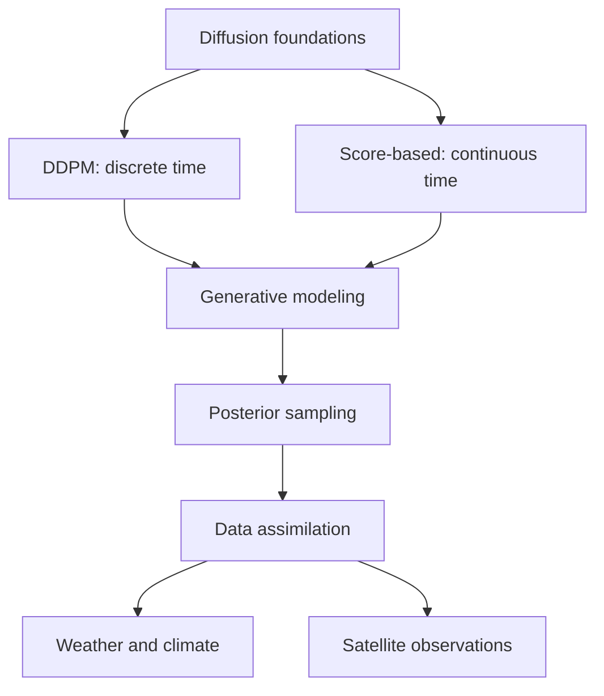

# Diffusion Models - Applications in Earth-System Sciences
**Summary: A structured knowledge base for generative modeling and atmospheric data assimilation.**

Welcome. This collection separates the **discrete-time DDPM perspective** from the **continuous-time score-based SDE perspective**, then connects both to Bayesian inverse problems and data assimilation.

This resource offers an extensive scientific overview of generative diffusion models, covering their mathematical principles and new uses in atmospheric and Earth system sciences.

Traditionally, numerical weather prediction (NWP) and Earth system modeling have depended on physics-driven numerical models, statistical estimation, and data assimilation to simulate atmospheric dynamics and interactions within the Earth system. Despite progress in modeling, observations, and computing power, challenges persist in accurately capturing multiscale atmospheric phenomena, quantifying forecast uncertainties, and integrating diverse observational data with model outputs.

Recent advances in artificial intelligence, especially generative diffusion models, present promising solutions to some of these issues. Diffusion models are probabilistic generative techniques that learn complex, high-dimensional probability distributions by applying a series of random perturbations followed by denoising steps. Unlike traditional deterministic machine learning methods, these models can produce multiple statistically valid samples, enabling better representation of uncertainty, probability estimation, and variability characterization in atmospheric and Earth system contexts.

This research atlas compiles a structured and continually updated set of theoretical insights, mathematical frameworks, key scientific references, computational methods, and potential applications related to diffusion-based generative modeling. It focuses particularly on two closely linked approaches:

- **Denoising Diffusion Probabilistic Models (DDPMs):** These models use a discrete-time stochastic process where increasing noise gradually transforms data samples into an approximately Gaussian distribution. A learned reverse process then reconstructs samples from the original distribution. This approach supports probabilistic generation, conditional sampling, and uncertainty quantification.

- **Score-Based Generative Models:** These methods learn the score function—the gradient of the log probability density—and utilize stochastic differential equations (SDEs) to model the continuous-time evolution of probability distributions. The reverse-time SDE and related probability-flow ordinary differential equation (ODE) serve as mathematical tools for sample generation. This continuous-time framework links score matching, diffusion processes, and probabilistic inference.

Although often treated as separate, DDPMs and score-based models share underlying stochastic processes and denoising goals. Understanding their mathematical relationships, numerical implementations, and computational traits is crucial for assessing their applicability in scientific research.

A key emphasis of this atlas is the growing application of diffusion models in atmospheric data assimilation. Traditional assimilation methods—such as 3D-Var, 4D-Var, ensemble Kalman filtering (EnKF), and hybrid ensemble-variational techniques—combine observations with prior model information to estimate atmospheric states. Diffusion-based methods offer a complementary probabilistic framework where learned prior distributions merge with observation likelihoods to generate samples approximating the posterior atmospheric state distribution.

These approaches are especially relevant for scenarios involving nonlinear observation operators, non-Gaussian background errors, diverse satellite data, high-resolution atmospheric variables, and flow-dependent uncertainties. However, deploying them operationally in NWP demands thorough evaluation of physical realism, computational demands, statistical calibration, observation integration, and forecast accuracy compared to established assimilation systems.

Overall, this collection aims to bridge generative probabilistic modeling, stochastic mathematics, Bayesian inference, and atmospheric data assimilation. By combining foundational literature, mathematical explanations, reproducible computational examples, and selected weather and climate applications, the atlas supports scientific understanding, methodological innovation, and critical assessment of diffusion-based techniques for Earth system forecasting.

The content is organized progressively, starting with the mathematical basis of diffusion processes, then covering discrete-time DDPMs, continuous-time score-based models, diffusion-based Bayesian inverse problems and data assimilation, and concluding with applications in numerical weather prediction and Earth system sciences.

## Explore the research areas

| Section | Start here |
|---|---|
| 🧭 Foundations | [Diffusion concepts and notation](foundations/index.md) |
| 🧪 DDPM | [Discrete-time denoising diffusion](ddpm/index.md) |
| 🌊 Score-based models | [Scores, SDEs and probability flow](score-based/index.md) |
| 🌦️ Data assimilation | [Generative DA for atmospheric states](data-assimilation/index.md) |
| 🛰️ Applications | [Weather, remote sensing and uncertainty](applications/index.md) |
| 📚 Reading path | [Suggested progression](reading-lists/index.md) |

## Research map

## Curatorial principles

- Link primary sources, official code repositories and reproducible results.
- Record mathematical assumptions, datasets and observational settings.
- Mark research gaps rather than asserting unsupported conclusions.
- Maintain a separate, machine-readable [BibTeX library](https://github.com/) in `references/references.bib` (in the repository root).
