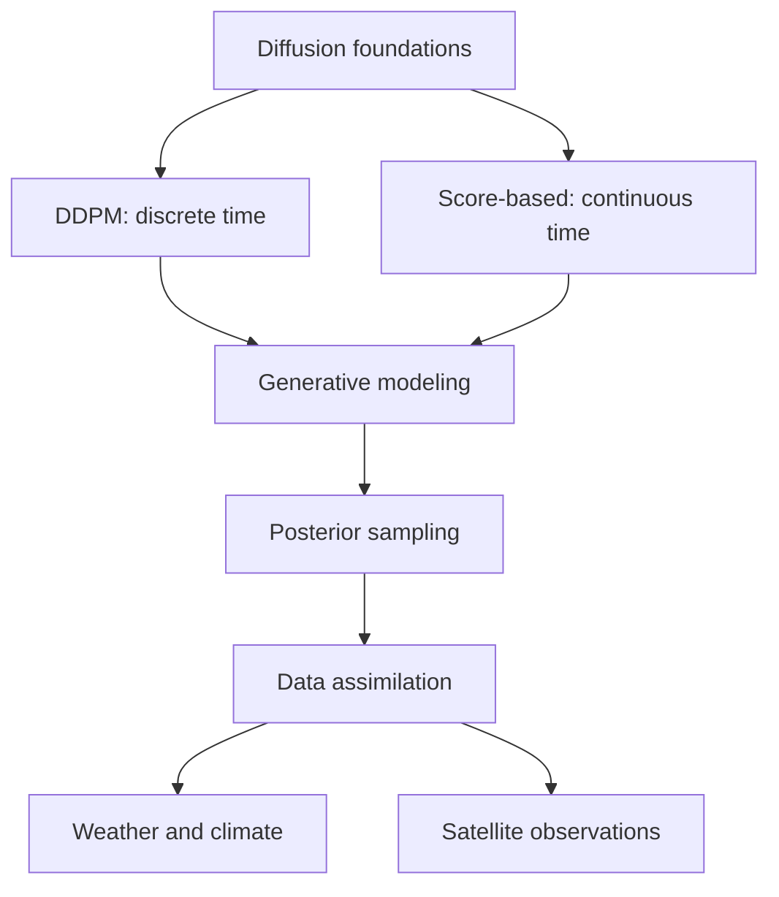

# Diffusion Models — Research Atlas

**A structured knowledge base for generative modeling and atmospheric data assimilation.**

Welcome. This collection separates the **discrete-time DDPM perspective** from the **continuous-time score-based SDE perspective**, then connects both to Bayesian inverse problems and data assimilation.

## Explore the research areas

| Section | Start here |
|---|---|
| 🧭 Foundations | [Diffusion concepts and notation](foundations/index.md) |
| 🧪 DDPM | [Discrete-time denoising diffusion](ddpm/index.md) |
| 🌊 Score-based models | [Scores, SDEs and probability flow](score-based/index.md) |
| 🌦️ Data assimilation | [Generative DA for atmospheric states](data-assimilation/index.md) |
| 🛰️ Applications | [Weather, remote sensing and uncertainty](applications/index.md) |
| 📚 Reading path | [Suggested progression](reading-lists/index.md) |

## Research map

## Curatorial principles

- Link primary sources, official code repositories and reproducible results.
- Record mathematical assumptions, datasets and observational settings.
- Mark research gaps rather than asserting unsupported conclusions.
- Maintain a separate, machine-readable [BibTeX library](https://github.com/) in `references/references.bib` (in the repository root).
